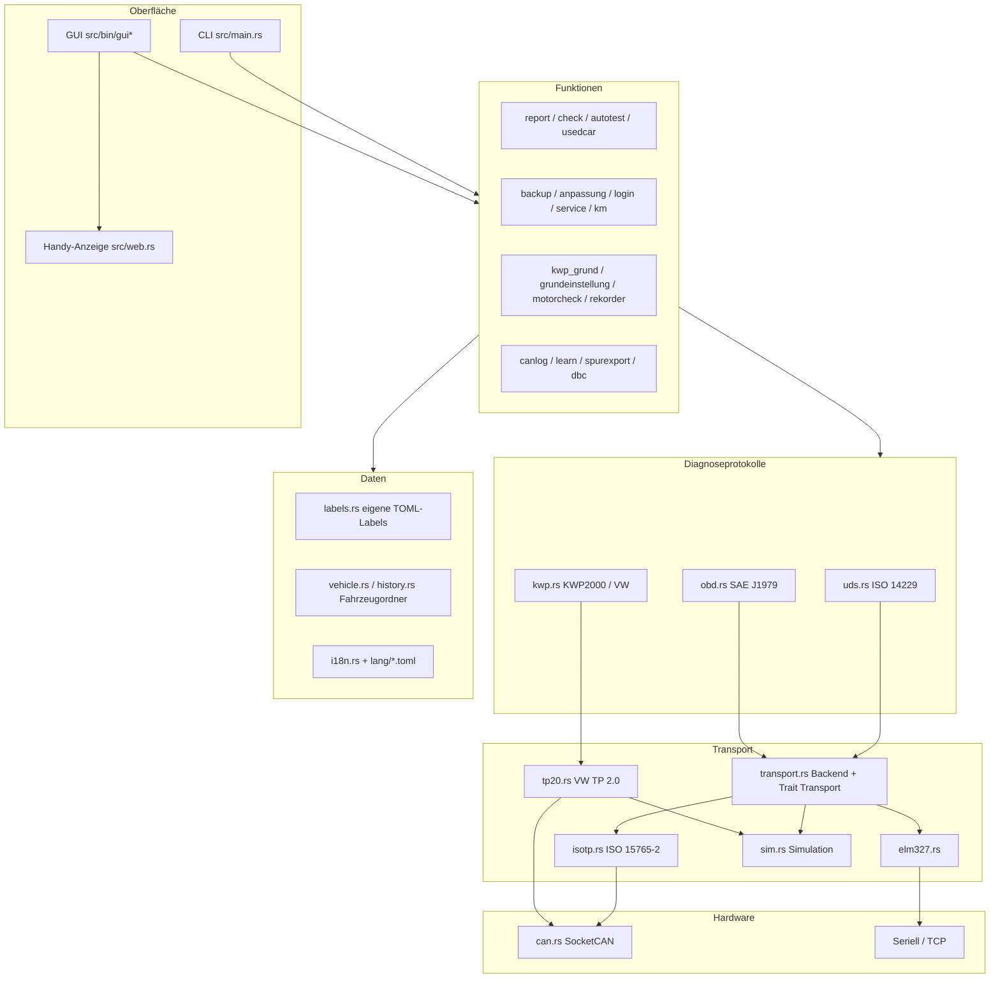

# Architektur von ECUWerkbank

Stand: 18.11.2026 (Version 0.2.0 + Entwicklungsstand). Diese Datei beschreibt, wie das
Programm aufgebaut ist, wie die Daten zum Steuergerät kommen und wo man es erweitert.
Für eigene Beiträge siehe [CONTRIBUTING.md](CONTRIBUTING.md), für Erweiterungen
[PLUGIN_DEVELOPMENT.md](PLUGIN_DEVELOPMENT.md).

## Überblick

Ein Rust-Projekt, zwei Programme, eine gemeinsame Bibliothek:

| Teil | Datei | Aufgabe |
|---|---|---|
| Bibliothek `ecu_werkbank` | `src/lib.rs` + ~70 Module | Protokolle, Funktionen, Datenhaltung |
| CLI `ecu-werkbank` | `src/main.rs` | ~110 Befehle (clap), dünne Schicht über der Bibliothek |
| GUI `ecu-werkbank-gui` | `src/bin/gui.rs` + `src/bin/gui/*.rs` | egui/eframe-Oberfläche |
| Prüf-Steuergerät `mockecu` | `src/bin/mockecu.rs` | UDS-Gegenstelle auf `vcan0` |

Abhängigkeiten sind bewusst wenige: `clap`, `anyhow`, `serde`/`toml`, `libc`,
`serial2`, `eframe`/`egui_plot`, `rfd`. PDF, ZIP, PCAP, DBC und HTTP sind selbst geschrieben.

## Schichten

## Kommunikationswege

| Weg | Kette | Wofür | Hinweise |
|---|---|---|---|
| UDS über SocketCAN | `uds.rs` → `transport::Backend::open` → `isotp.rs` → `can.rs` | Autos ab ~2008 | Standardweg, volle Geschwindigkeit |
| UDS über ELM327 | `uds.rs` → `elm327.rs` (AT-Befehle, seriell/TCP) | billige Adapter | kein TP 2.0; Flusssteuerung per `ATFCSH/ATFCSD` |
| KWP2000 über TP 2.0 | `kwp.rs` → `tp20.rs` (Kanalaufbau 0x200, Blockgröße, ACK) → `can.rs` | VW-Konzern ~2004–2012 | nur SocketCAN oder Simulation |
| OBD-II | `obd.rs` → `transport` | alle Marken | Modi 01–0A |
| Simulation | `sim.rs` (`DemoUds`, `DemoCanIo`) | Tests, Handbuch-Bilder, Vorführung | Modelle „Demo“ und „Golf 6“ (`-t demo`, `-t golf6`) |
| Mitschnitt | `can.rs` → candump-Text → `canlog.rs` / `learn.rs` / `spurexport.rs` / `dbc.rs` | Abläufe lernen, Wireshark | nur lesen |

Wer gerade den Bus benutzt, merkt sich `bus.rs` (damit die Fahrzeug-Erkennung im
Hintergrund nicht dazwischenfunkt).

### Ablauf einer UDS-Anfrage

1. `Backend::open(tx, rx)` öffnet eine ISO-TP-Verbindung (Punkt-zu-Punkt).
2. `Uds::request(sid, daten)` sendet, wartet, behandelt:
   - `0x7F … 0x78` (Antwort folgt): weiter warten, höchstens 60 s
   - `0x7F … 0x21` (besetzt): bis zu 5× wiederholen
   - verspätete fremde Antworten: überspringen
3. Positive Antwort ohne SID zurück, sonst Fehler mit NRC-Klartext.

### Ablauf einer TP-2.0-Sitzung

1. `kwp::open_session` → `Backend::open_tp20(adresse)`: Kanalaufbau über 0x200,
   Antwort mit den Kanal-IDs, Parameter (Blockgröße, Zeiten).
2. Sitzung `0x10 0x89`, dann KWP-Dienste (`0x1A`, `0x18`, `0x21`, `0x22`, `0x31` …).
3. Kanal schließen (`0xA8`). „Vorübergehend nicht verfügbar“ wird mit Wartezeiten wiederholt.

## Module nach Aufgabe

| Gruppe | Module |
|---|---|
| Hardware/Transport | `can`, `isotp`, `tp20`, `elm327`, `transport`, `bus`, `connect`, `erkennung` |
| Protokolle | `uds`, `kwp`, `obd`, `login` |
| Diagnose | `report`, `check`, `autotest`, `swinfo`, `verbauliste`, `systems`, `profil`, `fremd`, `readiness`, `guide`, `dtc_db`, `fehlergeruest` |
| Codierung/Anpassung | `backup`, `anpassung`, `codiertexte`, `kennungstexte`, `service`, `km`, `retrofit`, `kwp_grund`, `grundeinstellung` |
| Messen | `motorcheck`, `rekorder`, `mixture`, `dpf`, `battery`, `control`, `csvlog`, `chart`, `limits`, `trend`, `favoriten`, `messwerttexte`, `mwvorschlag` |
| CAN-Analyse | `canlog`, `learn`, `spurexport`, `dbc` |
| Daten/Ablage | `labels`, `vehicle`, `history`, `datensicherung`, `notfall`, `zip`, `kalender`, `kosten`, `akte`, `wissen`, `fehlertexte`, `vcds` (Import von Auto-Scan-Texten) |
| Ausgabe | `pdf`, `web`, `i18n` |
| Test | `sim`, `bin/mockecu` |

## Datenablage

- **Datenordner** (`~/.local/share/ecu-werkbank`, über `VAG_DATA_DIR` änderbar):
  ein Ordner je Fahrzeug (VIN) mit Scans, Berichten, Codier- und Anpassungs-Sicherungen,
  Trends, Profil. Der Umzug vom alten Namen `vag-diag` passiert einmal automatisch.
- **Labels** (`~/.config/…/labels`): eigene TOML-Dateien je Steuergerät. Nie fremde Label-Dateien.
- **Sprachen**: `lang/<code>.toml` eingebaut, eigene im Datenordner unter `sprachen/`.

## Sicherheitsprinzipien im Code

- Schreiben nur mit ausdrücklicher Bestätigung (`--ja` bzw. Häkchen in der GUI).
- Vorher sichern, nachher neu lesen (Codierung, Anpassung, Kurzcodierung).
- Schreibwege, die noch nicht per Mitschnitt am Auto bestätigt sind, laufen am echten
  Auto nur als **Probelauf** (`kwp::LANGCODIERUNG_GEPRUEFT` usw.).
- Kilometerstand wird nie geschrieben (`km.rs`, Test `kilometerstand_nie_schreiben`).
- Siehe [SECURITY_REVIEW.md](SECURITY_REVIEW.md).

## Technische Schulden

| Stelle | Problem | Vorschlag |
|---|---|---|
| `src/main.rs` (≈4 300 Zeilen) | alle CLI-Befehle in einer Datei, Enum mit ~110 Varianten | in `src/cli/<gruppe>.rs` aufteilen |
| `src/bin/gui.rs` `struct App` (≈317 Felder) | ein großer Zustand für alle Seiten | je Seite eine eigene Zustands-Struktur |
| GUI-Aufrufe am Bus (≈90× `self.backend()`) | viele laufen im Zeichen-Thread → Fenster friert bei langsamen Steuergeräten kurz ein | einheitlicher Hintergrund-Auftrag mit Kanal (wie bei Stellglieddiagnose/Blockscan) |
| NRC-Tabellen | dreifach: `uds.rs`, `kwp.rs`, `canlog.rs` | eine gemeinsame Tabelle |
| Steuergeräte-Wissen | verteilt auf `systems.rs`, `kwp::tp20_name`, `profil.rs`, `sim.rs` | Daten-Ordner je Hersteller (siehe ROADMAP, Punkt „Herstellerdaten“) |
| `unwrap()` außerhalb von Tests (≈300) | meist Mutex/Format, wenige echte Risiken | nach und nach durch `?`/`unwrap_or_else` ersetzen |
| CI | nur ein manueller Mac-Lauf | Linux-Lauf mit `cargo test` + `clippy` bei jedem Push |
| `canlog::Decoder` | liest ganze Datei in den Speicher | für sehr große Mitschnitte zeilenweise lesen |

## Leistung

- **TP-2.0-Suche** über alle 127 Adressen ≈ 8 s; mit Gateway-Verbauliste oder Profil nur die verbauten Kanäle.
- **ELM327**: jede Anfrage mehrere AT-Runden; für Live-Werte deutlich langsamer als SocketCAN.
- **Blockierende GUI-Aufrufe** (siehe oben) sind die spürbarste Bremse.
- **Simulation** hält einen globalen Mutex — für Tests mit `TEST_LOCK` nacheinander.
