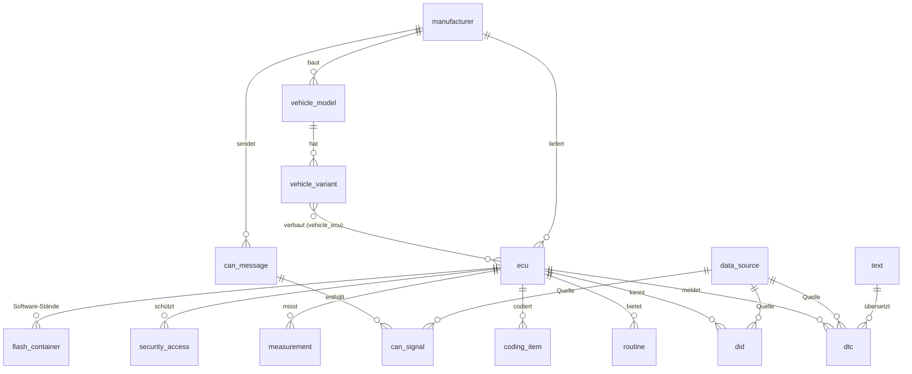

# Roadmap

Stand: 18.11.2026. Vergleich mit den bekannten Werkstatt- und Hersteller-Programmen
(VCDS, ODIS, ISTA+, E-Sys, Xentry, Autel MaxiSys) — **nur nach dem, was diese
Programme öffentlich können**, nicht nach ihren Daten. ECUWerkbank übernimmt keine
Inhalte (Labels, Datenbanken, Flash-Dateien, Schlüssel) aus diesen Programmen.

**Grenzen eines offenen Projekts:** Hersteller-Programme leben von Daten, die nur der
Hersteller hat (Steuergeräte-Beschreibungen, Flash-Container, Online-Freischaltungen wie
SFD/FEC/Login-Server). Diese Lücke schließt ECUWerkbank über **eigene, offene Daten**:
Mitschnitte, eigene Labels, gelernte Abläufe — Schritt für Schritt und nachprüfbar.

Legende: Nutzen/Aufwand/Risiko = niedrig · mittel · hoch. Risiko = Gefahr für Auto oder Daten.
Status: ✅ erledigt · 🟡 teilweise · ⏳ offen

## Die 50 wichtigsten fehlenden Funktionen

| # | Funktion | Vorbild | Nutzen | Aufwand | Risiko | Priorität | Stufe | Status |
|---|---|---|---|---|---|---|---|---|
| 1 | UDS ECUReset (0x11) | alle | mittel | niedrig | niedrig | hoch | Quick Win | ✅ `ecu-reset` |
| 2 | UDS CommunicationControl / ControlDTCSetting (0x28/0x85) | ODIS, E-Sys | mittel | niedrig | mittel | hoch | Quick Win | ✅ Bausteine in `uds.rs` |
| 3 | UDS Download/Upload/TransferData/Exit (0x34–0x37) | ODIS, E-Sys, Xentry | hoch | niedrig | mittel | hoch | Quick Win | ✅ Bausteine (kein Flash-Ablauf) |
| 4 | Fehleranzahl und erweiterte Fehlerdaten (0x19 01/06) | alle | mittel | niedrig | niedrig | hoch | Quick Win | ✅ |
| 5 | Vollständige NRC-Klartexte | alle | mittel | niedrig | niedrig | hoch | Quick Win | ✅ |
| 6 | Begrenztes Warten bei „Antwort folgt“ | – | mittel | niedrig | niedrig | hoch | Quick Win | ✅ 60 s |
| 7 | Mitschnitt als PCAP (Wireshark) / ASC | Autel, CANalyzer | mittel | niedrig | niedrig | hoch | Quick Win | ✅ `log-export` |
| 8 | DBC-Signale entschlüsseln | CANalyzer, SavvyCAN | hoch | niedrig | niedrig | hoch | Quick Win | ✅ `dbc-decode` |
| 9 | Codier-Helfer: Rückgängig / alles zurück | VCDS, ODIS | mittel | niedrig | niedrig | hoch | Quick Win | ✅ |
| 10 | Handy-Anzeige mit Zugangsschlüssel | – | mittel | niedrig | niedrig | hoch | Quick Win | ✅ |
| 11 | TP 2.0: lange Codierung schreiben | VCDS | hoch | mittel | hoch | hoch | 1.0 | 🟡 eingebaut, Probelauf bis Mitschnitt |
| 12 | TP 2.0: Anpassung schreiben | VCDS | hoch | mittel | hoch | hoch | 1.0 | 🟡 eingebaut, Probelauf bis Mitschnitt |
| 13 | TP 2.0: Einzelmesswerte (Funktion 09) | VCDS | niedrig | niedrig | niedrig | mittel | 1.0 | ⏳ |
| 14 | TP 2.0: Umgebungsbedingungen direkt | VCDS | mittel | mittel | niedrig | mittel | 1.0 | ⏳ |
| 15 | UDS: Anpassungskanäle mit Namen + Schreiben ohne Login, wo erlaubt | VCDS, ODIS | hoch | mittel | mittel | hoch | 1.0 | 🟡 lesen/sichern |
| 16 | UDS: Gateway-Verbauliste (neuere Gateways) | VCDS, ODIS | hoch | mittel | niedrig | hoch | 1.0 | ⏳ Mitschnitt nötig |
| 17 | Geführte Funktionen (Bremsbelag-Wechselstellung, Lenkwinkel-Grundeinstellung, Drosselklappe) | VCDS, Autel | hoch | mittel | hoch | hoch | 1.0 | 🟡 Drosselklappe/KWP |
| 18 | Service-Rückstellung für weitere Modelle | Autel, VCDS | hoch | mittel | mittel | hoch | 1.0 | 🟡 Golf 6 |
| 19 | Batterie anlernen (BEM/Batteriewechsel) | Autel, ISTA+ | hoch | mittel | mittel | hoch | 1.0 | ⏳ |
| 20 | Herstellerdaten als Daten-Ordner (`manufacturers/<marke>/`) | alle | hoch | mittel | niedrig | hoch | 1.0 | ⏳ Plan unten |
| 21 | Steuergerätebaum (Bus → Gateway → Steuergeräte) in der GUI | ODIS, ISTA+ | mittel | mittel | niedrig | mittel | 1.0 | ⏳ |
| 22 | Live-CAN-Monitor in der GUI (IDs, Rate, Änderungen) | SavvyCAN, Autel | hoch | mittel | niedrig | hoch | 1.0 | ✅ Werkzeuge → CAN-Monitor, mit Rauschfilter |
| 23 | DBC in der GUI (Signale live, ins Scope) | CANalyzer | hoch | mittel | niedrig | mittel | 1.0 | ✅ CAN-Monitor → 📈 → Live-Grafik |
| 24 | Mitschnitt abspielen (Replay auf vcan) | CANalyzer | mittel | niedrig | mittel | mittel | 1.0 | ⏳ nur auf vcan, nie am Auto |
| 25 | Bus-Arbeit der GUI im Hintergrund (kein Einfrieren) | – | hoch | mittel | niedrig | hoch | 1.0 | ✅ `gui/hintergrund.rs` |
| 26 | Linux-CI: Tests + Clippy + cargo audit bei jedem Push | – | hoch | niedrig | niedrig | hoch | 1.0 | ✅ `.github/workflows/pruefen.yml` |
| 27 | CLI in Gruppen-Dateien aufteilen | – | mittel | mittel | niedrig | mittel | 1.0 | ⏳ |
| 28 | Integrationstests über `vcan0` + `mockecu` | – | mittel | mittel | niedrig | mittel | 1.0 | 🟡 mockecu vorhanden |
| 29 | Codierung: Klartext-Assistent mit Abhängigkeiten (Bit A nur mit Bit B) | ODIS, E-Sys | hoch | mittel | mittel | mittel | 2.0 | ⏳ |
| 30 | Fahrzeug-Konfiguration als Ganzes vergleichen (vorher/nachher, zwei Autos) | E-Sys | mittel | niedrig | niedrig | mittel | 1.0 | 🟡 `compare`, Nachrüst-Assistent |
| 31 | DoIP (Diagnose über Ethernet, neuere VW/BMW) | ODIS, ISTA+, E-Sys | hoch | hoch | mittel | mittel | 2.0 | ⏳ |
| 32 | 29-Bit-CAN-IDs und CAN FD | Xentry, Autel | mittel | mittel | niedrig | mittel | 2.0 | 🟡 Mitschnitt liest sie |
| 33 | K-Line (KWP1281/KWP2000 vor ~2004) | VCDS | mittel | hoch | mittel | niedrig | 2.0 | ⏳ braucht anderen Adapter |
| 34 | J2534 Pass-Thru-Adapter (Windows) | ODIS, Xentry | hoch | hoch | mittel | mittel | 2.0 | ⏳ |
| 35 | Weitere Marken: Basis-Diagnose Opel/Ford/Mercedes/BMW über UDS + OBD | Autel | hoch | hoch | mittel | mittel | 2.0 | 🟡 `fremd.rs` findet Steuergeräte |
| 36 | ECU-Sicherung (Speicher auslesen, wo erlaubt) | Autel, Flash-Tools | mittel | mittel | mittel | mittel | 2.0 | ⏳ Baustein `read_memory` |
| 37 | Flash-Ablauf (siehe Abschnitt Flashing) | ODIS, E-Sys, Xentry | hoch | hoch | **hoch** | niedrig | Vision | ⏳ |
| 38 | Spannungsüberwachung während langer Abläufe | ODIS, ISTA+ | hoch | niedrig | niedrig | hoch | 1.0 | 🟡 Batterietest vorhanden |
| 39 | REST-Schnittstelle (lokal, mit Schlüssel) | – | mittel | mittel | mittel | mittel | 2.0 | ⏳ (`web.rs` als Grundlage) |
| 40 | Skripte (Lua oder Rhai, eingebettet) | – | mittel | mittel | mittel | niedrig | 2.0 | ⏳ |
| 41 | Python-Anbindung (pyo3 oder REST) | – | mittel | mittel | niedrig | niedrig | Vision | ⏳ |
| 42 | Plugin-Schnittstelle für Fahrzeug-Funktionen | – | mittel | hoch | mittel | niedrig | Vision | ⏳ |
| 43 | Fehler-Erklärung lokal (eigene Wissensbasis + Wahrscheinlichkeit aus eigener Historie) | Autel | mittel | mittel | niedrig | mittel | 2.0 | 🟡 Fehlerbilder, Prüfpläne |
| 44 | Mitschnitt-Analyse mit Auffälligkeiten (Zeitüberschreitungen, NRC-Häufung) | – | mittel | niedrig | niedrig | mittel | 1.0 | ✅ `auffaelligkeiten.rs` im Prüfbericht (`decode-log`, GUI) |
| 45 | MDF4-/BLF-Export | CANalyzer | niedrig | hoch | niedrig | niedrig | Vision | ⏳ |
| 46 | Dashboard / frei belegbare Instrumente | Autel | mittel | mittel | niedrig | mittel | 2.0 | 🟡 Armaturen/Scope |
| 47 | Drag-and-Drop (Mitschnitte, Sicherungen, DBC ins Fenster ziehen) | – | niedrig | niedrig | niedrig | mittel | 1.0 | ✅ `gui/ablegen.rs` (Sicherungen nur mit Hinweis) |
| 48 | Responsive Layout (kleine Bildschirme, Tablet) | Autel | mittel | mittel | niedrig | mittel | 2.0 | 🟡 |
| 49 | Berichte mit Firmenkopf / Kunde (Werkstattbetrieb) | Autel, ODIS | mittel | niedrig | niedrig | mittel | 1.0 | ✅ Firmenkopf in jeder PDF-Fußzeile (`firmenkopf`, GUI Fahrzeuge); Kunde über Kennzeichen/Notiz |
| 50 | Online-Funktionen der Hersteller (SFD, FEC, Online-Login) | ODIS, E-Sys | – | – | – | **nicht geplant** | – | ❌ nur mit Herstellerzugang, nicht offen nachbaubar |

## Erweiterung: Fahrzeug-Datenbank (Punkte 51–60)

Plan siehe unten „Plan: Fahrzeug-Datenbank“. Baut auf Punkt 20 (Herstellerdaten) auf und ersetzt ihn langfristig.

| # | Funktion | Vorbild | Nutzen | Aufwand | Risiko | Priorität | Stufe | Status |
|---|---|---|---|---|---|---|---|---|
| 51 | Datenbank-Kern: SQLite-Schema, Migrationen, Repository-Schicht | ODIS, ISTA+ | hoch | mittel | niedrig | hoch | 1.0 | ✅ `src/db/`, CLI `db` |
| 52 | Vorhandenes Wissen übernehmen (Labels, `systems.rs`, Profile, Fehlertexte) | – | hoch | mittel | niedrig | hoch | 1.0 | ✅ Adressliste + Labels übernehmbar; Fehlertexte aus der Datenbank überall sichtbar |
| 53 | Quellen- und Lizenzverwaltung je Datensatz (`data_source`) | – | hoch | niedrig | niedrig | hoch | 1.0 | ✅ `db quellen`, `db entfernen`, `darf_weitergeben` |
| 54 | Importer DBC, JSON, CSV, TOML | CANalyzer | hoch | mittel | niedrig | hoch | 1.0 | ✅ `db dbc/paket/csv/labels`, Export `db export` |
| 55 | Community-Daten als Textdateien im Repo, beim Start in die Datenbank | – | hoch | mittel | niedrig | mittel | 2.0 | ✅ `daten/community/`, `db eingebaut` |
| 56 | REST-Schnittstelle auf die Datenbank (lesen) | – | mittel | mittel | mittel | mittel | 2.0 | ⏳ zusammen mit 39 |
| 57 | ODX-Import (selbst gekaufte Daten, bleiben lokal) | ODIS | hoch | hoch | mittel | mittel | 2.0 | ⏳ |
| 58 | PDX-Import (ODX-Paket als ZIP) | ODIS | mittel | mittel | mittel | niedrig | 2.0 | ⏳ nach 57 |
| 59 | Rollen und Rechte (lesen, codieren, flashen, verwalten) | ODIS | mittel | niedrig | niedrig | mittel | 2.0 | ⏳ wichtig erst mit REST |
| 60 | Plugin-Ordner `plugins/` (Hersteller, Importer, Decoder, Codierer, Flasher, Analyse) | – | mittel | hoch | mittel | niedrig | Vision | ⏳ |

## Stufen

**Quick Wins (erledigt am 18.11.2026):** Punkte 1–10.

**Version 1.0 — „Golf 6 vollständig, zweites Auto geprüft“:**
11/12 am Auto bestätigen, 13–19, 20 (Herstellerdaten), 21–28, 30, 38, 44, 47, 49.
Prüfstein: Polo 6R und Golf 6 komplett ohne Werkstattgerät diagnostizierbar.

**Version 2.0 — „neuere Autos und andere Marken“:**
29, 31–36, 39, 40, 43, 46, 48.

**Langfristige Vision:** 37 (Flashen), 41, 42, 45, 60.

**Fahrzeug-Datenbank:** 51–54 zu 1.0, 55–59 zu 2.0, 60 Vision.

## Plan: Herstellerdaten (Punkt 20)

Heute steckt Fahrzeugwissen in `systems.rs`, `kwp::tp20_name`, `profil.rs`, `grundeinstellung.rs`
und `labels/`. Ziel: ein Daten-Ordner je Hersteller, ohne neu zu bauen erweiterbar:

```
manufacturers/
  vw/        hersteller.toml   steuergeraete.toml   messwerte/   fehlertexte/   routinen.toml   codierung/
  audi/ seat/ skoda/           (erben von vw: erbt = "vw")
  bmw/ mercedes/ opel/ ford/   (zunächst nur OBD + gefundene UDS-Adressen)
```

- Inhalt nur aus eigenen Mitschnitten, offenen Normen und öffentlich freien Quellen — Herkunft je Eintrag (`quelle = "Mitschnitt Golf 6, 17.11.2026"`).
- Lesen über ein neues Modul `hersteller.rs`; die bisherigen Tabellen werden zu Standardwerten im Code und nach und nach in Dateien verschoben.
- Einzelheiten zum Dateiformat: [PLUGIN_DEVELOPMENT.md](PLUGIN_DEVELOPMENT.md).
- Langfristig werden diese Dateien zu Community-Daten der Fahrzeug-Datenbank (siehe unten, Punkte 51–60). Das Dateiformat bleibt dabei als Import erhalten.

## Plan: Flashing (Punkt 37)

Bewusst zuletzt — ein Fehler macht ein Steuergerät unbrauchbar. Voraussetzungen, bevor
überhaupt ein Byte geschrieben wird:

1. Spannung laufend prüfen (≥ 12,5 V, Ladegerät Pflicht), Abbruch unter Grenzwert.
2. VIN, Teilenummer, Hardware- und Softwarestand gegen die Flash-Datei prüfen.
3. Vorher vollständige Sicherung (Codierung, Anpassungen, Identifikation).
4. Prüfsummen (CRC) der Datei und der übertragenen Blöcke; Blockzähler (in `uds::transfer_data` schon geprüft).
5. Wiederaufnahme nach Abbruch (Recovery: Bootloader-Sitzung erneut öffnen).
6. Nur offene Flash-Dateien (z. B. selbst gebaute Firmware für Prüf-Steuergeräte) — keine Hersteller-Container.
7. Erst am Prüfstand (`vcan` + Simulation, dann ein Steuergerät auf dem Tisch), nie zuerst am Auto.

## Plan: Entwicklerplattform (Punkte 39–42)

1. **REST** auf Basis von `web.rs`: nur `127.0.0.1` als Standard, Schlüssel wie bei der Handy-Anzeige;
   lesen frei, schreiben nur mit Bestätigung im Programm.
2. **Skripte**: eingebettete Sprache (Rhai oder Lua über `mlua`) mit denselben Funktionen wie die CLI.
3. **Python**: über die REST-Schnittstelle (kein eigener Build nötig).

## Plan: Fahrzeug-Datenbank (Punkte 51–60)

**Ziel:** Fahrzeugwissen (Hersteller, Modelle, Steuergeräte, Kennungen, Fehler,
Codierung, Messwerte, CAN-Signale) liegt nicht mehr im Programmcode, sondern in einer
Datenbank. Der Programmkern kennt keinen Hersteller. Daten kommen aus offenen
Community-Dateien, eigenen Mitschnitten und — nur beim Nutzer — aus selbst gekauften
OEM-Daten (ODX/PDX).

### Grundsätze

- **Herstellerunabhängig, keine fest eingebauten OEM-Daten.** Das Projekt liefert nur offene Daten.
- **Offline:** alles lokal, kein Server nötig.
- **Jeder Datensatz kennt seine Quelle** (`source_id` → `data_source` mit Art, Version, Lizenz). Daraus folgt, was angezeigt, exportiert oder veröffentlicht werden darf.
- **Versionierbar:** Schema-Version mit Migrationen; Community-Daten in Git; jede Quelle mit Versionsnummer.
- **Mehrsprachig:** Texte in einer eigenen Tabelle je Sprache statt Spalten `title_de`, `title_en`.
- **Sicherheit vor Vollständigkeit:** Security Access nur als Beschreibung (Level, Länge von Seed/Key), **keine Schlüssel-Verfahren** von Herstellern. Flash-Container nur als Metadaten und Prüfsumme, die Dateien selbst liefert das Projekt nie (siehe „Plan: Flashing“).

### Datenmodell



Tabellen wie im Vorschlag: `manufacturer`, `vehicle_model`, `vehicle_variant`, `ecu`,
`did`, `dtc`, `uds_service`, `diagnostic_session`, `security_access`, `routine`,
`coding_item`, `measurement`, `flash_container`, `can_message`, `can_signal`,
`data_source`, `permission`. **Ergänzungen:**

| Ergänzung | Warum |
|---|---|
| `vehicle_ecu` (Variante ↔ Steuergerät, mit Diagnoseadresse) | Ein Steuergerät steckt in vielen Varianten; ohne Zwischentabelle doppelte Daten. |
| `text` (`schluessel`, `sprache`, `inhalt`) | Mehrsprachigkeit ohne Schema-Änderung je neuer Sprache. |
| `source_id` + `gueltig_ab_version` in jeder Wissenstabelle | Lizenz und Herkunft je Zeile; mehrere Quellen für dasselbe Steuergerät nebeneinander. |
| `protocol` als eigene Liste (UDS, KWP2000/TP 2.0, KWP1281, OBD) | Ältere VW-Steuergeräte (TP 2.0) haben Messwertblöcke statt DIDs; `measurement` bekommt dafür `block` und `feld`. |
| `uds_service`, `diagnostic_session` als Normdaten | Stammen aus ISO 14229, gehören keinem Hersteller; werden mit dem Programm ausgeliefert. |

### Technische Entscheidungen

| Entscheidung | Vorteil | Nachteil |
|---|---|---|
| **SQLite** (eingebettet, `rusqlite` mit `bundled`) statt PostgreSQL | eine Datei, offline, keine Installation, schnell beim Lesen, Sicherung = Datei kopieren | ein Schreiber zur Zeit (reicht für ein Desktop-Programm); für einen zentralen Community-Server später eigenes System |
| **Community-Daten als Textdateien** (TOML/JSON) im Repo, Datenbank als Zwischenspeicher | Änderungen prüfbar in Pull-Requests, Herkunft im Git-Verlauf, keine Binärdatei im Repo | beim Start oder Update einmal einlesen (wenige Sekunden) |
| **Eigene Nutzerdaten** in einer zweiten Datei (`nutzer.sqlite`) | Community-Update überschreibt nie eigene Daten; ODX-Importe bleiben getrennt und lokal | Abfragen über zwei Dateien (`ATTACH`) |
| **Migrationen** über `PRAGMA user_version` und nummerierte SQL-Dateien im Programm | einfach, ohne Zusatzwerkzeug, Test je Migration | nur vorwärts; vorher automatische Sicherung |
| **Repository- und Service-Schicht** als Rust-Module (`db/`, Traits je Bereich) | GUI, CLI und REST nutzen dieselben Funktionen; Tests mit Speicher-Datenbank | etwas mehr Code als direkte SQL-Aufrufe |
| **Importer als Rust-Trait**, zuerst fest eingebaut | sicher (kein fremder Code), schnell | neue Formate brauchen ein neues Programm, bis Punkt 60 kommt |
| **Plugins zuerst nur als Daten-Ordner**, fremder Code erst später (z. B. WASM in einer Sandbox) | fremder Code kann nichts ans Auto senden, was nicht bestätigt wird | Code-Plugins kommen spät |
| **Cache** im Speicher: nur das aktive Fahrzeug (Steuergeräte, Texte), gefüllt beim Wählen | schnelle Anzeige, wenig Speicher | erste Abfrage je Fahrzeug etwas langsamer |

### Größe und Leistung

Ausgelegt für 100 Hersteller, 10 000 Modelle, 100 000 DIDs und 1 000 000 CAN-Signale:

- 1 Mio. Signale × ca. 120 Byte sind etwa 120 MB in SQLite. Mit Index auf `can_message_id` und `(manufacturer_id, can_id)` dauert eine Abfrage weniger als 1 ms.
- **Gemessen am 18.11.2026** (Test `db::tests::grosse_datenmenge`, Release-Build): Import von 1 Mio. Signalen in 6,1 s, Abfrage aller Signale einer Botschaft 0,07 ms, Datei 133 MB.
- Volltextsuche (Fehlertexte, Namen) über SQLite **FTS5**.
- Import großer Dateien in **einer** Transaktion mit vorbereiteten Anweisungen: über 100 000 Zeilen pro Sekunde.
- `WAL`-Modus: Die GUI kann lesen, während ein Import schreibt.
- Die Datenbank wird nie vollständig in den Speicher geladen, nur das aktive Fahrzeug (siehe Cache).

### Import

| Format | Inhalt | Hinweis |
|---|---|---|
| DBC | CAN-Botschaften und -Signale | Leser vorhanden (`dbc.rs`) |
| JSON, CSV, TOML | alle Tabellen, festes Spaltenformat | auch für Community-Daten |
| ODX (ASAM MCD-2D, XML) | Steuergeräte, DIDs, Fehler, Routinen, Codierung | großer Aufwand; nur Daten, die der Nutzer rechtmäßig besitzt |
| PDX | ZIP mit ODX-Dateien | nach ODX |

Jeder Import legt einen `data_source`-Eintrag an (Art, Name, Version, Lizenz, Zeitpunkt)
und lässt sich als Ganzes wieder entfernen.

### Lizenzen

- `source_type`: `COMMUNITY`, `ODX`, `PDX`, `DBC`, `USER`, `MANUAL`.
- **COMMUNITY:** nur frei lizenzierte, nachprüfbare Daten (eigene Mitschnitte, Normen, freie Lizenzen mit Namensnennung). Sie werden mit dem Programm ausgeliefert.
- **ODX/PDX:** bleiben ausschließlich in der Nutzer-Datenbank. Sie werden nie exportiert, nie ins Repo übernommen und nie an die Community geschickt; das Programm verhindert es technisch über `source_type`. Ob die Nutzung erlaubt ist, regelt der Kaufvertrag des Nutzers.
- **Keine Daten aus Werkstatt-Programmen** (Label-Dateien, verschlüsselte Datenbanken), auch nicht über einen Importer.

### Sicherung

- Die Nutzer-Datenbank ist Teil der vorhandenen Datensicherung (ZIP). Kopiert wird über die SQLite-Backup-Schnittstelle, die auch im laufenden Betrieb eine stimmige Kopie liefert.
- Vor jeder Migration und jedem großen Import wird automatisch eine Kopie angelegt.
- Community-Daten lassen sich jederzeit aus dem Repo neu aufbauen.

### Schnittstelle (REST, mit Punkt 39)

Nur `127.0.0.1`, Schlüssel wie bei der Handy-Anzeige, Version im Pfad:

```
GET  /api/v1/hersteller                     GET  /api/v1/steuergeraete/{id}/dids
GET  /api/v1/fahrzeuge?vin=WVW…             GET  /api/v1/steuergeraete/{id}/fehler/{code}
GET  /api/v1/can/botschaften/{id}/signale   GET  /api/v1/quellen
POST /api/v1/import   (nur Rolle „verwalten“, Datei + Quellenangabe)
```

Die Schnittstelle schreibt nur in die Datenbank, nie ans Auto. Schreiben ans Auto
bleibt in der GUI und CLI mit Bestätigung.

### Projektstruktur (Ziel)

```
src/db/          schema.rs  migration.rs  repo/ (je Tabelle)  dienst/ (Abfragen für GUI/CLI/REST)  cache.rs
src/import/      mod.rs (Trait Importer)  dbc.rs  json.rs  csv.rs  toml.rs  odx.rs  pdx.rs
daten/community/ <hersteller>/*.toml      (im Repo, nur offene Daten)
plugins/         manufacturers/  importers/  decoders/  coders/  flashers/  analyzers/   (Punkt 60)
```

### Reihenfolge

1. **D1 (51, 53):** Schema, Migrationen, Repository; Tests mit Speicher-Datenbank.
2. **D2 (52):** Labels, `systems.rs`, Profile und Fehlertexte in die Datenbank; GUI und CLI lesen daraus, die alten Dateien bleiben als Import.
3. **D3 (54, 55):** Importer DBC, JSON, CSV, TOML; Community-Ordner im Repo.
4. **D4 (56, 59):** REST lesend, Rollen.
5. **D5 (57, 58):** ODX/PDX-Import, zuerst nur DIDs und Fehler.
6. **D6 (60):** Plugins; Flasher-Plugins erst, wenn „Plan: Flashing“ erfüllt ist.
